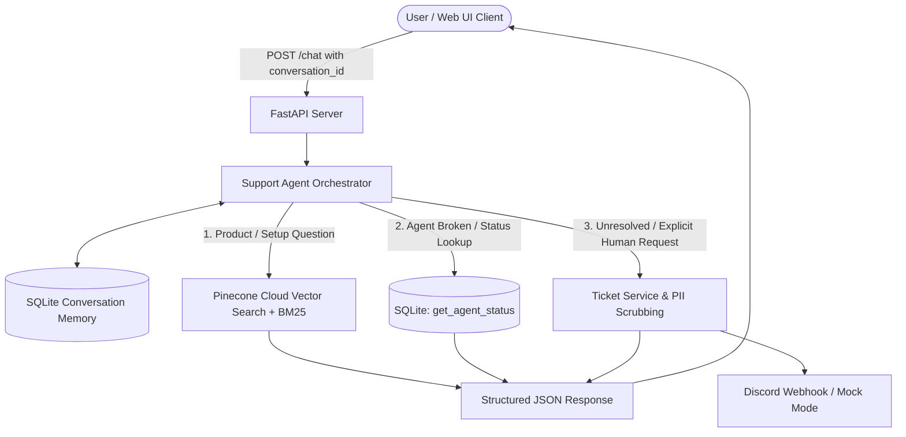

# Ampere AI Customer Support Agent

An autonomous, multi-turn AI Customer Support Agent for **Ampere** (managed hosting for OpenClaw AI assistants).

The system handles product inquiries using official documentation (with cited links), diagnoses broken assistants via SQLite account lookups, remembers conversation context across turns, and escalates unresolved issues to human engineers via Discord webhooks with strict PII scrubbing.

---

## 🏗️ Architecture



---

## 🌟 Core Features

### 1. Document Search & Pinecone Cloud Vector RAG
- **Source:** Scraped from official Ampere documentation at `https://docs.ampere.sh/docs` across 13 core topics.
- **Cloud Vector DB:** Connected to Pinecone serverless index (`ampere-docs`, 70 vectors) with dense embedding search and BM25 keyword matching.
- **Behavior:** Direct, synthesized answers citing the exact Ampere page URLs (`doc_links`).
- **Strict Fallback:** If documentation does not cover a topic, the agent explicitly states: *"Ampere's documentation does not cover this topic"* rather than hallucinating.

### 2. SQLite Database Account Lookup (`get_agent_status`)
- Single table `accounts` keyed by registered email address.
- **Pre-seeded Accounts:**
  | Email | Status | Agent Action / Diagnosis |
  | :--- | :--- | :--- |
  | `priya@example.com` | `running` | Healthy, nothing to fix. |
  | `rahul@example.com` | `offline` | Explains diagnosis: Missing API key. Advises dashboard settings fix. |
  | *Any other email* | `not_found` | Informs user no account exists for that email address. |
- **Rule Enforcement:** Tool is only invoked when an account problem or broken assistant is being discussed.

### 3. Multi-Turn Conversation Memory
- Tracks distinct threads using `conversation_id`.
- **Dynamic Context Injection:** Extracts the active email and injects `ACTIVE CONVERSATION MEMORY` into the system prompt.
- **Priority Resolution:** Current message emails always take priority over older emails in conversation history.
- **Context Retention:**
  - Turn 1: *"My assistant is broken"* ➔ Agent asks for registered email address (`needs_clarification`).
  - Turn 2: *"rahul@example.com"* ➔ Agent calls `get_agent_status` and diagnoses offline status (`answered`).
  - Turn 3: *"My agent is broken"* ➔ Agent automatically reuses Rahul's email from memory without asking again.

### 4. Human Escalation & Ticket Deduplication
- **Triggers:**
  - Explicit user request (*"I need a person"*, *"Talk to support"*, *"Human agent"*).
  - Unresolved issues after troubleshooting (e.g., repeating failure after API key fix advice).
- **Safety Interceptor:** Detects natural-language escalation promises from the LLM and guarantees a real ticket ID is generated even if the model omitted the tool call.
- **Doc Link Suppression:** When escalated, `doc_links` is strictly set to `[]` to prevent irrelevant documentation links on escalation messages.
- **PII Scrubbing:** Strips emails, passwords, API keys, tokens, and phone numbers before generating ticket summaries or posting to Discord.
- **Discord Webhook:** Posts formatted embeds to Discord. Operates in mock mode when offline or without credentials.
- **Fault Tolerance:** If webhook delivery fails, status is `escalation_pending` rather than `escalated`.
- **Deduplication:** Only one ticket per issue/conversation is created; subsequent calls return the existing ticket ID.

### 5. Interactive Live Web UI
- Served directly at `http://localhost:8000/`.
- Sleek dark console featuring preset prompts, conversation switcher, live JSON contract inspector, and webhook failure toggle.
- **Chat Management:** `＋ New Chat` button to spawn clean sessions and `🗑` button to wipe all conversation history.

---

## 🚀 Quickstart Guide

### 1. Prerequisites
- Python 3.10+ (tested on Python 3.14)

### 2. Environment Setup
```bash
# Clone and enter directory
cd /path/to/ai_support_agent

# Create and activate virtual environment
python3 -m venv .venv
source .venv/bin/activate

# Install dependencies
pip install -r requirements.txt
```

### 3. Environment Configuration
Copy `.env.example` to `.env`:
```bash
cp .env.example .env
```
Key configuration options:
- `OPENROUTER_API_KEY`: OpenRouter API key (e.g. `sk-or-v1-...`) for dynamic LLM reasoning and embeddings.
- `PINECONE_API_KEY`: Pinecone API key for cloud vector search.
- `PINECONE_INDEX_NAME`: Pinecone index name (default: `ampere-docs`).
- `DISCORD_WEBHOOK_URL`: Discord webhook endpoint (leave blank for built-in mock mode).

### 4. Start the Server
```bash
source .venv/bin/activate
uvicorn src.api:app --reload --host 0.0.0.0 --port 8000
```
Open **[http://localhost:8000](http://localhost:8000)** in your browser to access the live web console!

---

## 🧪 Running the Automated Test Suite

Run all unit, integration, and API contract tests using `pytest`:
```bash
source .venv/bin/activate
pytest -v
```

All **31 automated test cases** pass with zero regressions:
- **`tests/test_api.py` (9 tests):** Conversational turn scenarios, multi-turn clarification, status lookups, escalation flow, webhook fault tolerance, ticket deduplication, uncovered docs fallback, and schema validation.
- **`tests/test_db_tools.py` (4 tests):** Seed accounts lookups, Priya healthy status, Rahul offline status, unknown accounts, case and whitespace insensitivity.
- **`tests/test_escalation.py` (3 tests):** Ticket creation, Discord webhook dispatch, ticket deduplication per conversation, and failure fault tolerance.
- **`tests/test_memory.py` (2 tests):** SQLite conversation history persistence and distinct conversation isolation.
- **`tests/test_pii.py` (4 tests):** PII scrubbing of emails, API keys, passwords, and multi-element redactions.
- **`tests/test_prompt_injection.py` (6 tests):** Instruction override refusal, memory reset refusal, system prompt leak defense, DAN jailbreak defense, unauthorized escalation override defense, and legitimate query passthrough.
- **`tests/test_rag.py` (3 tests):** Documentation search for agent creation, credits and pricing, and irrelevant query hallucination rejection.

---

## 📡 API Contract (`POST /chat`)

### Request
```http
POST /chat
Content-Type: application/json

{
  "conversation_id": "conv-1234",
  "message": "My agent is broken."
}
```

### Response
```json
{
  "conversation_id": "conv-1234",
  "answer": "Could you please provide your registered email address so I can check the status of your assistant?",
  "doc_links": [],
  "outcome": "needs_clarification",
  "ticket_id": null
}
```

### Outcome Status Values
| Value | Description |
| :--- | :--- |
| `answered` | Answered from docs or diagnosed via account lookup. |
| `needs_clarification` | Asking follow-up questions (e.g., asking for email address). |
| `escalated` | Ticket created and successfully posted to Discord webhook. |
| `escalation_pending` | Ticket created, but Discord webhook dispatch failed. |

### Additional API Endpoints
- `GET /api/accounts`: Lists all accounts and diagnoses in SQLite.
- `GET /api/conversations`: Returns recent conversation threads with message count and preview.
- `DELETE /api/conversations`: Wipes all conversation messages and tickets from the database.
- `POST /api/simulate-webhook-failure`: Toggles fault tolerance mode for Discord webhook simulation.

---

## 📂 Project Structure

```
ai_support_agent/
├── data/
│   ├── ampere_support.db        # SQLite database (seed accounts, memory, tickets)
│   └── docs/
│       └── scraped_docs.json    # Scraped Ampere official documentation dataset
├── src/
│   ├── agent.py                 # Multi-turn conversational orchestrator & memory
│   ├── api.py                   # FastAPI server & route handlers
│   ├── config.py                # Environment configuration & API keys
│   ├── database.py              # SQLite storage, seeding, & conversation memory
│   ├── llm.py                   # LLM client with OpenRouter tool calling & safety interceptors
│   ├── pii.py                   # PII redaction (emails, keys, passwords, tokens)
│   ├── rag.py                   # Pinecone cloud vector search & BM25 retrieval
│   ├── scraper.py               # Documentation crawler & extractor
│   ├── tools.py                 # Tool execution handlers & function schemas
│   ├── webhook.py               # Discord webhook dispatcher with mock mode
│   └── static/                  # Interactive Live Web Console
│       ├── index.html
│       ├── style.css
│       └── app.js
├── tests/
│   ├── test_api.py              # End-to-end conversational turn tests
│   ├── test_db_tools.py         # SQLite & get_agent_status tests
│   ├── test_escalation.py       # Ticketing, webhook & deduplication tests
│   ├── test_memory.py           # Multi-turn conversation persistence tests
│   ├── test_pii.py              # PII scrubbing tests
│   ├── test_prompt_injection.py # Prompt injection defense tests
│   └── test_rag.py              # Docs search & unknown fallback tests
├── pytest.ini
├── requirements.txt
├── .env.example
├── .gitignore
└── README.md
```

---

## ⚠️ Known Limitations & What Broke

### 1. Conversational Escalation Without Tool Invocation (Turn 4)
**What broke:** When an issue remained unresolved after troubleshooting, the LLM generated natural-language text (*"Since the issue is unresolved, I will escalate to human support. Creating a ticket now..."*) without emitting the formal `escalate_to_human` tool call. As a result, `outcome` defaulted to `"answered"`, no ticket was created in SQLite or sent to Discord, and unrelated documentation links were backfilled.

**Fix applied:** Added a deterministic safety interceptor in `src/llm.py` that catches conversational escalation intent. When detected, the interceptor automatically executes `execute_escalate_to_human`, sets `outcome = "escalated"`, assigns a canonical ticket ID, and suppresses doc links.

### 2. Multi-Turn Email Priority Inversion
**What broke:** When a user tested `rahul@example.com` and subsequently tested `priya@example.com` in the same chat, Priya was incorrectly diagnosed as offline with a missing API key.

**Root cause:** The email lookup helper searched `conversation_history` before `user_message`. Because Rahul's email was already present in history, it overrode Priya's email.

**Fix applied:** Updated `_find_user_email()` to strictly prioritize the current `user_message`. If the user provides a new email, it immediately takes precedence over historical emails.

### 3. Redundant Email Prompts Across Multiple Turns
**What broke:** After diagnosing an account, if the user reiterated *"my agent is broken"* several turns later, the LLM treated it as a fresh query and asked for their email address again.

**Fix applied:** Injected `ACTIVE CONVERSATION MEMORY` into the system prompt with the user's active email, and added an interceptor that reroutes redundant `ask_clarification` calls directly to `get_agent_status(known_email)`.

### 4. Ticket ID Discrepancy Between Discord and Database
**What broke:** The original escalation handler in `tools.py` generated a temporary ID (`tick-{conv_id[-6:]}`) for Discord while `create_ticket()` generated an internal UUID. Human engineers seeing the Discord alert could not locate the matching ticket in the database.

**Fix applied:** A canonical ticket ID (`tick-{uuid[:8]}`) is now generated *before* dispatch and shared between both Discord and SQLite records.

---

## 🔐 Security Notes

- **`.env` is strictly excluded in `.gitignore`** and will never be committed.
- All PII (emails, API keys, passwords, phone numbers) is stripped from ticket summaries and Discord notifications via `src/pii.py`.
- Prompt-injection attempts (e.g. instruction resets, DAN jailbreaks, system prompt leak attempts) are refused safely in both LLM mode and fallback mode.
